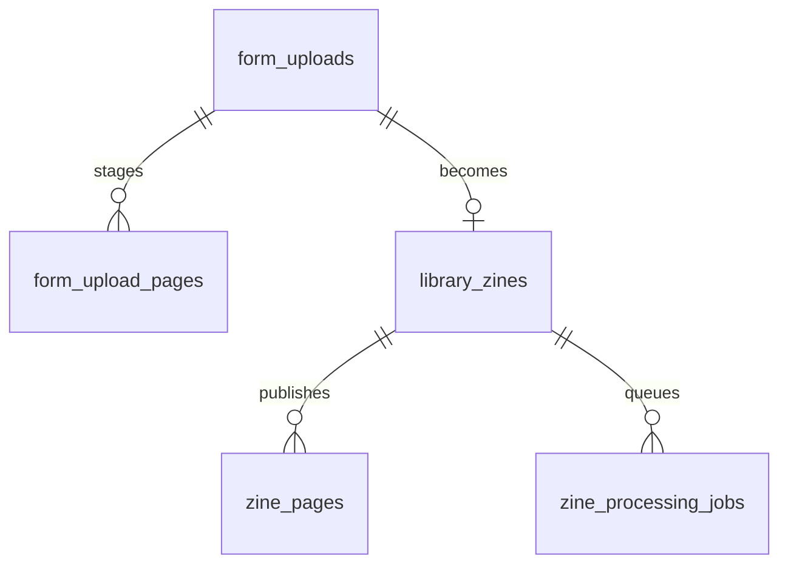
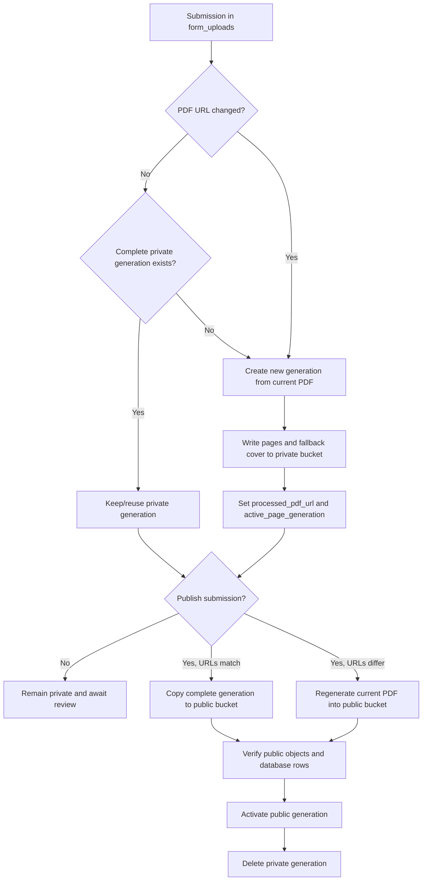

# Page Processing and Asset Lifecycle

This specification defines how Biblioteca de Zines turns submitted PDF sources into page and cover derivatives. It is the operational reference for processing code, storage buckets, publication transitions, and cleanup rules.

## Status

The generation-aware rendering, form-upload staging schema, queue types, and local processing commands exist. The two-bucket copy path, explicit rejected/withdrawn states, automated retention cleanup, and automatic worker workflow remain implementation work. This document describes the target contract those components must satisfy.

## Scope

The system processes a submitted PDF into page and cover derivatives. A submission may be processed before review, converted into a catalogue publication, edited, published, unpublished, republished, rejected, or withdrawn.

The submitted PDF URL remains the source reference. R2 objects are derivatives, not the original file or proof of rights.

## Domain Boundaries

| Relation | Role | Visibility |
| --- | --- | --- |
| `form_uploads` | Intake/submission record | Private workflow data |
| `form_upload_pages` | Processing generations for a submission | Private staging derivatives |
| `library_zines` | Catalogue/publication record | Public only when `is_published = true` |
| `zine_pages` | Page generations associated with a catalogue publication | Public delivery derivatives |
| `zine_processing_jobs` | Retryable queue for published-zine processing | Backend-only operational data |

There is no separate `library_zine_pages` table. `zine_pages.zine_id` is the publication-side page relation.

`form_uploads` and `library_zines` are related by `library_zines.source_upload_id` after a submission is converted into a publication.



## Storage Boundaries

The target architecture uses two R2 buckets:

| Bucket | Expected name | Purpose | Public access |
| --- | --- | --- | --- |
| Private processing | `biblioteca-de-zines` | Unpublished submission generations | Disabled |
| Public delivery | `biblioteca-de-zines-pb` | Published zine generations | Custom domain only |

The public bucket is served through `assets.biblioteca-de-zines.com.br`. The private bucket must not receive an R2.dev public URL or public custom domain.

The application selects the bucket from the asset target. A `form-upload` target writes to private storage; a `zine` target writes to public storage.

## Generation Rules

- Every processing run creates a new UUID `generation_id`.
- Generation objects are immutable and are never overwritten in place.
- A generation becomes active only after every page and required cover operation succeeds.
- A database pointer changes only after the complete generation is stored.
- A failed generation must not replace the last successful generation.
- Old generations are deleted only after a replacement is verified.

## Source URL Rules

The exact source string is the processing identity check:

```text
form_uploads.pdf_url === form_uploads.processed_pdf_url
```

- If the values match and the generation is complete, reuse the generation.
- If the values differ, regenerate from the current `pdf_url`.
- If `processed_pdf_url` is missing, regenerate.
- If the source URL is unchanged but a maintainer explicitly requests force processing, create a new generation.
- Metadata-only edits do not trigger PDF processing.

The same comparison applies when a linked `library_zines.pdf_url` is edited. The system must compare the previous value before saving the new value so unchanged URLs do not enqueue unnecessary work.

## Processing and Publication Flow



### First publication

- Matching `pdf_url` and `processed_pdf_url`: copy the complete private generation to the public bucket.
- Different or missing URLs: do not copy stale private pages; process the current PDF directly into a new public generation.
- Update `zine_pages`, `library_zines.active_page_generation`, `total_pages`, and the public cover URL only after the public generation is complete.

### Editing a submission

- Metadata-only changes update the submission and linked publication without processing.
- A changed PDF URL invalidates reuse of the prior processed generation.
- An unpublished submission may process the new PDF privately when explicitly requested; otherwise publication processes the current source.
- A published submission with a changed PDF URL queues a new public generation.
- The previous public generation remains active until the replacement succeeds.

### Unpublish and republish

- Unpublishing sets `library_zines.is_published = false`.
- Unpublishing does not delete public page objects by default.
- Republish reuses the active public generation when it still exists and the PDF URL has not changed.
- A changed PDF URL always creates a new generation before republishing.
- A withdrawal/takedown may delete public objects separately from ordinary unpublishing.

## Cover Workflow

- A submitter-provided `cover_image` is preserved and takes precedence over generated cover art.
- If no cover is supplied, the first PDF page is used as the default cover.
- The submission form must explain: “If you do not provide a cover image, we will use the first page of your PDF as the cover by default.”
- No opt-out field is required.
- A PDF change regenerates the first-page fallback cover.
- A metadata-only edit does not regenerate the cover.
- Adding or changing a custom cover does not require PDF processing.
- Removing a custom cover returns to the first-page fallback when a valid page generation exists.

## Cleanup and Retention

- Failed partial generations are deleted immediately.
- Private generations are deleted after a successful public copy or public regeneration is verified.
- Public generations remain available through ordinary unpublish/republish cycles.
- When a new public generation replaces an old one, delete the old public generation only after the new database pointer and page rows are committed.
- Rejected or withdrawn submissions retain private derivatives for 30 days.
- After 30 days, delete private generation objects and private page rows, but retain submission metadata for audit/history.
- Do not use `is_published = false` as a cleanup predicate; pending, rejected, withdrawn, and unpublished publication states are different concepts.

Explicit rejected/withdrawn state and a retention deadline are required before automated 30-day cleanup is enabled.

## Cost Policy

R2 Standard storage is inexpensive for page derivatives, and R2 egress is free. Reprocessing has additional runtime, source-download, failure, and latency costs. The system therefore avoids reprocessing when a complete generation is valid and retains public generations for normal republishing.

Current R2 pricing reference: [Cloudflare R2 pricing](https://developers.cloudflare.com/r2/pricing/).

## Implementation Components

| Component | Responsibility |
| --- | --- |
| `page-generation-module.ts` | Provider-neutral generation orchestration |
| `form-upload-generation-service.ts` | Submission-side generation entry point |
| `zine-import-service.ts` | Publication-side generation entry point |
| `source-download-service.ts` | Direct and Google Drive source acquisition |
| `pdf-service.ts` | PDF page rendering and canvas integration |
| `asset-storage.ts` | Provider-neutral storage contract |
| `r2-storage-service.ts` | R2 upload, copy, and cleanup adapter |
| `supabase-form-upload-page-repository.ts` | Private staging persistence |
| `supabase-zine-page-repository.ts` | Public publication persistence and promotion |
| `processing-job-module.ts` | Provider-neutral processing job contract |
| `supabase-processing-job-store.ts` | Queue, lease, retry, and failure persistence |
| `process-claimed-zine.ts` | Claimed-job execution and failure recording |
| `enqueue-zine-processing.ts` | Enqueues a publication for processing |
| `zine-processing-dispatch-service.ts` | Requests asynchronous worker dispatch |
| `scripts/migrate-pdf-covers.ts` | Explicit migration and form-upload processing |
| `scripts/process-pending-zines.ts` | Local queue worker |
| `src/app/api/internal/process-zines/route.ts` | Authenticated HTTP worker entry point |

The dispatch service currently targets `.github/workflows/process-pending-zines.yml`, but no checked-in workflow currently exists. That worker integration must be completed or the dispatch path must be changed before it is considered production-ready.
