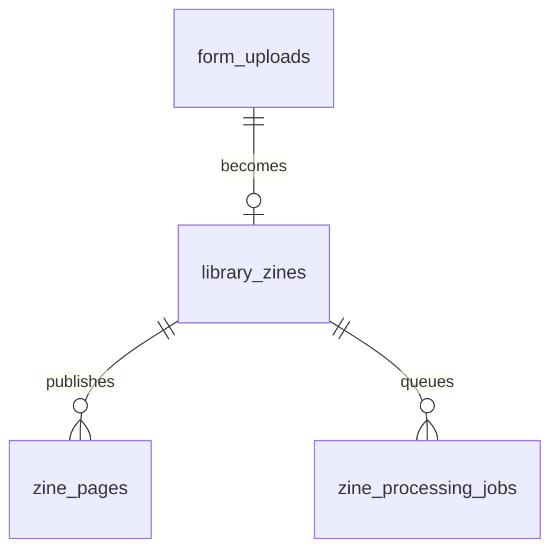
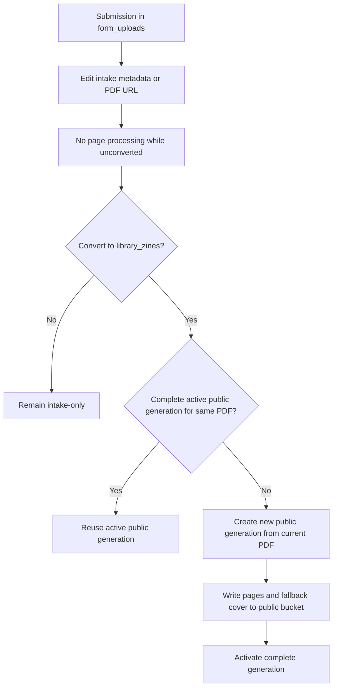

# Page Processing and Asset Lifecycle

This specification defines how Biblioteca de Zines turns submitted PDF sources into page and cover derivatives. It is the operational reference for processing code, storage buckets, publication transitions, and cleanup rules.

## Status

The full page-generation contract is preserved for future reader work. The current operational workflow is the cover-only contract in `cover-only-generation-and-migration.md`; queue and processed-source infrastructure are shared.

## Scope

The system processes a submitted PDF into page and cover derivatives. A submission may be processed before review, converted into a catalogue publication, edited, published, unpublished, republished, rejected, or withdrawn.

The submitted PDF URL remains the source reference. R2 objects are derivatives, not the original file or proof of rights.

## Domain Boundaries

| Relation | Role | Visibility |
| --- | --- | --- |
| `form_uploads` | Intake/submission record | Private workflow data |
| `library_zines` | Catalogue/publication record | Public only when `is_published = true` |
| `zine_pages` | Page generations associated with a catalogue publication | Public delivery derivatives |
| `zine_processing_jobs` | Retryable queue for published-zine processing | Backend-only operational data |

There is no separate `library_zine_pages` table. `zine_pages.zine_id` is the publication-side page relation.

`form_uploads` and `library_zines` are related by `library_zines.source_upload_id` after a submission is converted into a publication.



## Storage Boundaries

The active architecture uses one public delivery bucket:

| Bucket | Expected name | Purpose | Public access |
| --- | --- | --- | --- |
| Public delivery | `biblioteca-de-zines-pb` | Published zine generations | Custom domain only |

The bucket is served through `assets.biblioteca-de-zines.com.br`. `form_uploads` do not create R2 derivatives while they remain submissions.

The application processes only `zine` targets. The R2 bucket configured for processing is the public delivery bucket.

## Generation Rules

- Every processing run creates a new UUID `generation_id`.
- Generation objects are immutable and are never overwritten in place.
- A generation becomes active only after every page and required cover operation succeeds.
- A database pointer changes only after the complete generation is stored.
- A failed generation must not replace the last successful generation.
- Old generations are deleted only after a replacement is verified.

## Source URL Rules

The exact source string is stored on the publication and is the processing identity check:

```text
library_zines.pdf_url === library_zines.processed_pdf_url
```

- If the values match and the generation is complete, reuse the generation.
- If the values differ, regenerate from the current `pdf_url`.
- If `processed_pdf_url` is missing, regenerate.
- If the source URL is unchanged but a maintainer explicitly requests force processing, create a new generation.
- Metadata-only edits do not trigger PDF processing.

When a linked `library_zines.pdf_url` is edited, the system compares it with `processed_pdf_url` before deciding whether to enqueue work. `processed_pdf_url` changes only after a complete public generation succeeds.

## Processing and Publication Flow



### Publication

- A submission has no page generation while it remains a `form_upload`.
- On publication, process the current PDF directly into the public bucket unless a complete active generation already exists for the exact same URL.
- Update `zine_pages`, `library_zines.active_page_generation`, `total_pages`, and the public cover URL only after the public generation is complete.

### Editing a submission

- Metadata-only changes update the submission and linked publication without processing.
- A changed PDF URL on an unconverted submission requires no page work; publication uses the latest URL.
- A changed PDF URL on a published publication invalidates reuse of the prior public generation.
- A published submission with a changed PDF URL queues a new public generation.
- The previous public generation remains active until the replacement succeeds.

### Unpublish and republish

- Unpublishing sets `library_zines.is_published = false`.
- Unpublishing does not delete public page objects by default.
- Republish reuses the active public generation when it still exists and the PDF URL has not changed.
- A changed PDF URL always creates a new generation before republishing.
- A withdrawal/takedown may delete public objects separately from ordinary unpublishing.

## Cover Workflow

- A submitter-provided `cover_image` is preserved and takes precedence over generated cover art.
- If no cover is supplied, the first PDF page is used as the default cover.
- The submission form must explain: “If you do not provide a cover image, we will use the first page of your PDF as the cover by default.”
- No opt-out field is required.
- A PDF change regenerates the first-page fallback cover.
- A metadata-only edit does not regenerate the cover.
- Adding or changing a custom cover does not require PDF processing.
- Removing a custom cover returns to the first-page fallback when a valid page generation exists.

## Cleanup and Retention

- Failed partial generations are deleted immediately.
- Public generations remain available through ordinary unpublish/republish cycles.
- When a new public generation replaces an old one, delete the old public generation only after the new database pointer and page rows are committed.
- Rejected or withdrawn submissions create no derivatives and require no derivative cleanup.
- Do not use `is_published = false` as a processing predicate; a submission is processed only when converted into a publication.

## Cost Policy

R2 Standard storage is inexpensive for page derivatives, and R2 egress is free. Processing only at publication avoids storing private derivatives for submissions that may never be published. Reprocessing has additional runtime, source-download, failure, and latency costs, so a complete active public generation is reused when its source URL is unchanged.

Current R2 pricing reference: [Cloudflare R2 pricing](https://developers.cloudflare.com/r2/pricing/).

## Implementation Components

| Component | Responsibility |
| --- | --- |
| `page-generation-module.ts` | Provider-neutral generation orchestration |
| `zine-import-service.ts` | Publication-side generation entry point |
| `source-download-service.ts` | Direct and Google Drive source acquisition |
| `pdf-service.ts` | PDF page rendering and canvas integration |
| `asset-storage.ts` | Provider-neutral storage contract |
| `r2-storage-service.ts` | R2 upload, copy, and cleanup adapter |
| `supabase-zine-page-repository.ts` | Public publication persistence |
| `processing-job-module.ts` | Provider-neutral processing job contract |
| `supabase-processing-job-store.ts` | Queue, lease, retry, and failure persistence |
| `process-claimed-zine.ts` | Claimed-job execution and failure recording |
| `enqueue-zine-processing.ts` | Enqueues a publication for processing |
| `zine-processing-dispatch-service.ts` | Requests asynchronous worker dispatch |
| `scripts/migrate-pdf-covers.ts` | Explicit published-zine migration |
| `scripts/process-pending-zines.ts` | Local queue worker |
| `src/app/api/internal/process-zines/route.ts` | Authenticated HTTP worker entry point |

The dispatch service targets the checked-in `.github/workflows/process-pending-zines.yml` workflow. The workflow supports manual and scheduled execution; production credentials must be configured before relying on automatic processing.

## Legacy Schema

The applied migration `20261011010000_addFormUploadPageProcessing.sql` created `form_upload_pages` and form-upload processing columns before the process-on-publication decision. The cleanup migration `20261012000000_removeLegacyFormUploadPages.sql` removes them. Form uploads remain intake records; generated pages belong only to published zines.
